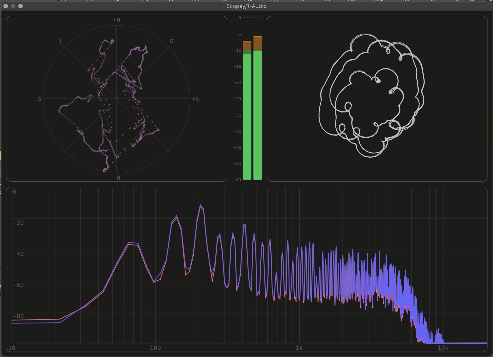

# Lindalë

Cross-platform audio plugin framework written in Odin, along with a set of demo plugins I'm developing using it. Currently targeting VST3 on Mac and Windows. Work in progress.

*Screenshot of a visualization plugin built with the framework.*

My aim is to create a framework that's a joy to use to experiment with audio plugin development, and to have a long-term learning project. The project is built around a hot-reloading architecture, so that the core audio processing and rendering/UI code can be recompiled and reloaded on the fly without restarting the plugin or the DAW. This is common in game development, and is used somewhat in audio DSP experimentation environments, but isn't usually done in audio plugin development. It's a huge benefit for iterating quickly while prototyping, learning DSP, and adjusting plugin UI.

I'm using the Odin language, which I find a perfect fit for audio programming. Builtin complex types, great SIMD and atomic support, very nice cross-platform development with platform bindings and objective-C subclassing, straightforward ways of plumbing custom allocators and loggers, and simple procedural code.

## Features
- Hot-reloading of plugin implementation code via a separate DLL, with atomic swapping and double buffering so the in-flight audio thread is never interrupted.
- Hardware-accelerated Metal/DX11 SDF instance shading for rendering UI elements and text with one shader.
- CLAY-style flexbox UI layout, with some UI primitives like buttons and sliders, and support for custom-drawn canvas widgets.
- A growing DSP library with filters, envelopes, very simple oscillators, etc.
- A few plugins I'm starting to build to exercise all these pieces. A scope plugin with a few different audio visualization views, a simple synth, an emulator for the Atari POKEY chip oscillators.

## Setting up dev environment
- Have the latest Odin compiler installed and in your path, along with a DAW to test in. I test regularly in Reaper and Ableton.
- A plugin consists of a root folder with build scripts which call into the framework's builder code, along with subfolders for the plugin implementation code, and one or more plugin format entry point shims.
- Builds are invoked using `build.sh`(mac)/`build.bat`(windows), which pass the Lindale collection path to the Odin compiler and run `build.odin`, which calls into the Lindale build system, written in Odin as well. Execute build commands by running `./build.[sh/bat] <command_name> [args]` while in a plugin's root directory. Everything I mention below implicitly uses this format.
- The build scripts read from a `lindale_collection.txt` file in the plugin directory, which should contain a path pointing to this repository's root directory locally. If the file doesn't exist, they will generate a default one which assumes Lindale is vendored as a submodule (`./lindale` as the collection path).
- Run the `build` command to build the plugin and install it. Each plugin builds into its own `out/<plugin>.vst3` bundle, and the script symlinks the bundle into a user VST3 folder (windows: `%LOCALAPPDATA%\Programs\Common\VST3`, mac: `~/Library/Audio/Plug-Ins/VST3`) and `out/hot` into the plugin's runtime folder.
- Run `hotbuild` to build just the hot-loaded DLL for the plugin. If a DAW is open with plugin instances, and hotloading isn't disabled, the running plugin instances will reload the UI and DSP code. Changes to the parameter list still require a full `build` and DAW reload.
- You can pass `-no-hot` to the `build` command to build one self-contained DLL.
- You can pass `-release` to the `build` or `hotbuild` commands to build an optimized build with no debug symbols.

## Creating a new plugin
Start with the `plugins/template` folder, copy it and rename the folder to your plugin name, and rename the internal plugin odin file. Rename all the data definitions and procedures in the plugin odin file, and in the plugin.ini manifest. If you want to vendor Lindale as a subdirectory, after setting up a git repo you can run `git submodule add https://github.com/jagnat/lindale.git lindale`. Otherwise, create `lindale_collection.txt` in the plugin root directory, and point it to your local Lindale directory. You can then run the build scripts to build your plugin.

## On AI

I've been using Claude to help with this project, mostly in the platform layers and rendering code, the DSP, which I'm still learning, and for debugging. In particular, I've leaned on Claude for MacOS specific code, since I'm very inexperienced with that platform still. But I vet and modify the code it generates extensively before committing.

## Roadmap
- DSP experimentation and improvements
- Rendering / UI improvements and customizability
- Support for more plugin formats beyond VST3
- Documentation and developer experience improvements
